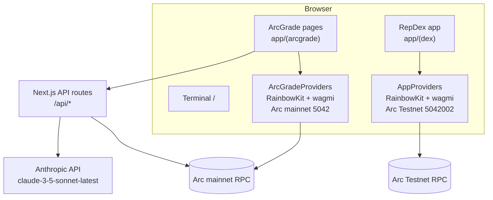

# RepDex

RepDex is a reputation-aware DEX terminal on Arc: check a wallet's on-chain reputation, then swap tokens through Uniswap v4.

## Overview

RepDex is the swap, bridge and liquidity application in this repository. It runs against Arc Testnet and uses Uniswap v4 contracts whose addresses are supplied through environment variables. The swap route implements quoting and swap transactions, but no pool is configured in `lib/dexConfig.testnet.ts` yet (`POOLS` is an empty map), so the swap action is disabled for every pair. The bridge and liquidity routes are UI scaffolds with their actions disabled.

ArcGrade is the on-chain reputation module that lives in the same codebase. It scores Arc mainnet wallets from transaction history, exposes a public JSON API, ships the Terminal landing page at `/`, and includes helpers for reading from and writing to the ArcTrust (ArcGrade) score contract.

## Naming glossary

| Name | What it refers to |
| --- | --- |
| RepDex | The DEX terminal: the `/swap`, `/bridge` and `/liquidity` routes plus the shared `app/(dex)` code. |
| ArcGrade | The reputation product: the `/arcgrade`, `/leaderboard`, `/my-score`, `/score/[address]`, `/challenge`, `/deploy` and `/api-docs` routes, the API routes, the scoring library and the Chrome extension. |
| ArcTrust | The deployed reputation smart contract in `contracts/ArcGrade.sol`. The contract and its Solidity identifier were renamed to ArcGrade, but "ArcTrust" is still used in older copy and comments. |
| TrustArc | The original repository name. Older paths, the remote URL and some package metadata may still say TrustArc or ArcGrade. |

## Products and status

| Product | Routes | Network | Status |
| --- | --- | --- | --- |
| RepDex swap | `/swap` | Arc Testnet (5042002) | Swap UI, quoting and transaction code are implemented. `POOLS` in `lib/dexConfig.testnet.ts` is empty, so no pair has a configured pool and the action is disabled with "No liquidity for this pair yet". The four Uniswap v4 addresses must also be set before a swap can be sent. |
| RepDex bridge | `/bridge` | Arc Testnet (5042002) | UI scaffold. The action button is disabled and the page states that bridging is not live. |
| RepDex liquidity | `/liquidity` | Arc Testnet (5042002) | UI scaffold. The action button is disabled and the page states that liquidity is not live. |
| ArcGrade Terminal | `/` | Arc mainnet (5042) | Landing page with links to the app and ArcGrade. |
| ArcGrade app | `/arcgrade`, `/leaderboard`, `/my-score`, `/score/[address]`, `/challenge`, `/deploy`, `/api-docs` | Arc mainnet (5042) | Functional. The leaderboard is seeded with a fixed list of demo addresses in `app/api/leaderboard/route.ts`. `/deploy` simulates compilation and deploys fixed demo bytecode. |
| ArcGrade API | `/api/analyze`, `/api/leaderboard`, `/api/v1/*` | Arc mainnet (5042) | Functional. See `app/(arcgrade)/api-docs/page.tsx` for the documented v1 endpoints. |

## Architecture

`app/layout.tsx` is the single root layout. It loads `app/globals.css`, sets the site metadata, and mounts the legacy wallet context from `hooks/useWallet.tsx` around every route; no current page reads that context. The application is split into two App Router route groups, each with its own wallet stack:

- `app/(arcgrade)` mounts `ArcGradeProviders` and talks to Arc mainnet (5042) through `lib/arcgradeWagmi.ts`.
- `app/(dex)` mounts `AppProviders` and talks to Arc Testnet (5042002) through `lib/appWagmi.ts`.



### Route table

| Route | Area | Network | Notes |
| --- | --- | --- | --- |
| `/` | Terminal | Arc mainnet | Landing page rendered by `app/TerminalPage.tsx`. |
| `/arcgrade` | ArcGrade | Arc mainnet | Reputation dashboard. |
| `/leaderboard` | ArcGrade | Arc mainnet | Ranked demo wallets. |
| `/my-score` | ArcGrade | Arc mainnet | Score for the connected wallet. |
| `/score/[address]` | ArcGrade | Arc mainnet | Score for an arbitrary address. |
| `/challenge` | ArcGrade | Arc mainnet | Compares two wallets. |
| `/deploy` | ArcGrade | Arc mainnet | Simulated contract deployment flow. |
| `/api-docs` | ArcGrade | Arc mainnet | Public API documentation. |
| `/swap` | RepDex | Arc Testnet | Uniswap v4 swap UI. |
| `/bridge` | RepDex | Arc Testnet | Bridge scaffold. |
| `/liquidity` | RepDex | Arc Testnet | Liquidity scaffold. |
| `/api/analyze` | API | Arc mainnet | `POST` wallet analysis. |
| `/api/leaderboard` | API | Arc mainnet | `GET` leaderboard. |
| `/api/v1/analyze` | API | Arc mainnet | `POST` v1 analysis. |
| `/api/v1/health` | API | Arc mainnet | `GET` health check. |
| `/api/v1/leaderboard` | API | Arc mainnet | `GET` v1 leaderboard. |
| `/api/v1/score/[address]` | API | Arc mainnet | `GET` score for an address. |
| `/api/v1/trusted/[address]` | API | Arc mainnet | `GET` trust decision; requires score >= 70. |

`next.config.js` permanently redirects `/app` and `/app/:path*` to `/swap`.

### Repository layout

```text
.
├── app/
│   ├── (arcgrade)/              ArcGrade app, Arc mainnet
│   │   ├── api-docs/
│   │   ├── arcgrade/
│   │   ├── challenge/
│   │   ├── deploy/
│   │   ├── leaderboard/
│   │   ├── my-score/
│   │   ├── score/[address]/
│   │   └── layout.tsx           Mounts ArcGradeProviders
│   ├── (dex)/                   RepDex app, Arc Testnet
│   │   ├── bridge/
│   │   ├── components/
│   │   ├── hooks/
│   │   ├── lib/
│   │   ├── liquidity/
│   │   ├── swap/
│   │   ├── app.css
│   │   ├── AppHeader.tsx
│   │   ├── DexView.tsx
│   │   ├── imported-tokens.tsx
│   │   ├── layout.tsx           Mounts AppProviders
│   │   └── providers.tsx
│   ├── api/                     Server routes for ArcGrade
│   ├── globals.css
│   ├── layout.tsx               Root layout, metadata and legacy WalletProvider
│   ├── page.tsx                 Terminal route
│   └── TerminalPage.tsx
├── chrome-extension/            ArcGrade browser extension source
├── components/                  Navbar, ArcGradeProviders, ScoreRing, ui/
├── contracts/ArcGrade.sol       ArcTrust / ArcGrade reputation contract
├── docs/                        Architecture notes and brand sources
├── hooks/                       useArcGradeWallet.tsx, legacy useWallet.tsx
├── lib/                         Chain config, wallet config, contract helpers, scoring
│   ├── abi/ArcGrade.json        ABI and bytecode used by the deploy script
│   ├── appChain.ts              Arc Testnet chain definition
│   ├── appWagmi.ts              RepDex wagmi config (Arc Testnet)
│   ├── arcgradeWagmi.ts         ArcGrade wagmi config (Arc mainnet)
│   ├── dexConfig.testnet.ts     Testnet tokens, pools and swap helpers
│   └── ...
├── public/                      Static assets, token and chain logos, extension zip
├── scripts/                     Standalone and Hardhat deploy scripts
├── types/                       Global type declarations
├── .github/                     CI and pull request template
├── hardhat.config.cjs
├── next.config.js
├── package.json
├── tailwind.config.js
├── tsconfig.json
└── vercel.json
```

## Tech stack

Versions are taken from `package.json`.

| Area | Package | Version |
| --- | --- | --- |
| Framework | `next` | 14.2.3 |
| UI | `react`, `react-dom` | 18.3.1 |
| Language | `typescript` | ^5 |
| Styling | `tailwindcss` | ^3.4.1 |
| Wallets | `wagmi` | ^2.14.0 |
| Wallets | `viem` | ^2.21.0 |
| Wallets | `@rainbow-me/rainbowkit` | ^2.2.0 |
| Data fetching | `@tanstack/react-query` | ^5.59.0 |
| EVM client | `ethers` | ^6.16.0 |
| AI verdict | `@anthropic-ai/sdk` | ^0.24.0 |
| Motion | `framer-motion` | ^11.18.2 |
| Icons | `lucide-react`, `@phosphor-icons/react` | ^1.65.0, ^2.1.10 |
| Solidity | `solc` | ^0.8.35 |
| Contracts tooling | `hardhat` | ^3.4.4 |
| Contracts tooling | `@nomicfoundation/hardhat-toolbox` | ^7.0.0 |

The reputation score is computed locally in `lib/scoring.ts`. Claude is only used to write the human-readable verdict in `app/api/analyze/route.ts` and `app/api/v1/analyze/route.ts`, and both routes call `claude-3-5-sonnet-latest`.

## Getting started

Prerequisites: Node.js 18.17.0 or later, which is the minimum required by Next.js 14.2.3. The repository does not pin a Node version; CI uses Node 20.

```bash
npm ci
cp .env.local.example .env.local
# fill in the values you need
npm run dev
```

Build and lint before opening a pull request:

```bash
npm run build
npm run lint
```

## Environment variables

Every variable prefixed with `NEXT_PUBLIC_` is exposed to the browser. Only `CLAUDE_API_KEY` and `DEPLOYER_PRIVATE_KEY` are secrets.

| Variable | Used by | Network | Required | Description |
| --- | --- | --- | --- | --- |
| `NEXT_PUBLIC_RPC_URL` | ArcGrade API and contract helpers, Hardhat, deploy script | Arc mainnet | No, defaults to `https://rpc.mainnet.arc.io` | Mainnet RPC endpoint. |
| `DEPLOYER_PRIVATE_KEY` | `hardhat.config.cjs`, `scripts/deploy-standalone.js` | Arc mainnet | Only for deployment | Deployer private key. Secret. |
| `CLAUDE_API_KEY` | `/api/analyze`, `/api/v1/analyze` | n/a | No | Anthropic API key for the verdict. Secret. |
| `NEXT_PUBLIC_CONTRACT_ADDRESS` | `lib/contract.ts` | Arc mainnet | No, but reads return null without it | ArcTrust (ArcGrade) contract address. |
| `NEXT_PUBLIC_CHAIN_ID` | `lib/contract.ts`, `hooks/useWallet.tsx` | Arc mainnet | No, defaults to `5042` | Mainnet chain ID. |
| `NEXT_PUBLIC_EXPLORER_URL` | `next.config.js` | Arc mainnet | No | Mainnet explorer URL. |
| `NEXT_PUBLIC_TESTNET_RPC_URL` | `lib/dexConfig.testnet.ts` | Arc Testnet | No, defaults to `https://rpc.testnet.arc.network` | Testnet RPC endpoint. |
| `NEXT_PUBLIC_TESTNET_EXPLORER_URL` | `lib/dexConfig.testnet.ts` | Arc Testnet | No, defaults to `https://testnet.arcscan.app` | Testnet explorer URL. |
| `NEXT_PUBLIC_WALLETCONNECT_PROJECT_ID` | `lib/appWagmi.ts` | Arc Testnet | No | WalletConnect project ID. Without it the WalletConnect option is hidden. |
| `NEXT_PUBLIC_UNIV4_POOL_MANAGER` | `lib/dexConfig.testnet.ts` | Arc Testnet | For swaps | Uniswap v4 PoolManager address. |
| `NEXT_PUBLIC_UNIV4_POSITION_MANAGER` | `lib/dexConfig.testnet.ts` | Arc Testnet | For swaps | Uniswap v4 PositionManager address. |
| `NEXT_PUBLIC_UNIV4_UNIVERSAL_ROUTER` | `lib/dexConfig.testnet.ts` | Arc Testnet | For swaps | Universal Router address. |
| `NEXT_PUBLIC_UNIV4_QUOTER` | `lib/dexConfig.testnet.ts` | Arc Testnet | For swaps | V4Quoter address. |
| `NEXT_PUBLIC_UNIV4_PERMIT2` | `lib/dexConfig.testnet.ts` | Arc Testnet | No | Permit2 override, checked first. |
| `NEXT_PUBLIC_PERMIT2` | `lib/dexConfig.testnet.ts` | Arc Testnet | No | Permit2 fallback, used only when `NEXT_PUBLIC_UNIV4_PERMIT2` is empty. Defaults to the canonical address. |
| `NEXT_PUBLIC_TOKEN_CIRBTC` | `lib/dexConfig.testnet.ts` | Arc Testnet | No | cirBTC address override. |
| `NEXT_PUBLIC_TOKEN_WETH` | `lib/dexConfig.testnet.ts` | Arc Testnet | No | WETH address override. |

## Networks

| Network | Chain ID | Native currency | RPC | Explorer |
| --- | --- | --- | --- | --- |
| Arc Testnet | 5042002 | USDC (18 decimals) | `https://rpc.testnet.arc.network` | `https://testnet.arcscan.app` |
| Arc Mainnet | 5042 | USDC (18 decimals) | `https://rpc.mainnet.arc.io` | `https://explorer.arc.io` |

## Smart contracts

`contracts/ArcGrade.sol` defines the ArcTrust (ArcGrade) reputation contract. It stores a score and last-updated timestamp per wallet, allows the owner or the authorized updater to write scores, records contract deployments, and emits `ScoreUpdated`, `UpdaterChanged`, `OwnershipTransferred` and `ContractDeployed` events.

The deployment address used by the app is `0xF98468E92dcE3e2653c200e44Cc2506a7839437A` on Arc mainnet, as set in `.env.local.example`.

The Uniswap v4 contracts are not part of this repository. They must be deployed separately on Arc Testnet and configured through `NEXT_PUBLIC_UNIV4_*` environment variables. The swap action stays disabled until all four addresses are present and a pool is configured in `lib/dexConfig.testnet.ts`.

## Scripts

| Command | Description |
| --- | --- |
| `npm run dev` | Start the Next.js development server. |
| `npm run build` | Production build. |
| `npm run start` | Serve the production build. |
| `npm run lint` | Run Next.js ESLint. |

Additional deployment scripts:

```bash
node scripts/deploy-standalone.js
npx hardhat run scripts/deploy.cjs --network arc
```

## ArcGrade scoring

The score is computed in `lib/scoring.ts` from wallet data fetched in `lib/arcApi.ts`.

| Component | Points | Formula |
| --- | --- | --- |
| Transaction count | 0-25 | `min(25, floor(txCount / 100 * 25))` |
| Wallet age | 0-20 | `min(20, floor(ageDays / 365 * 20))` |
| Consistency | 0-20 | `min(20, floor((txCount / max(ageDays, 1)) * 40))`, zero when there are no transactions or no age |
| Average value | 0-20 | `min(20, floor(log1p(avgTxValue) * 6))` |
| Reliability | 0-15 | `max(0, floor(15 * (1 - (failedTxCount / txCount) * 3)))`, 15 when there are no transactions |

The total is capped at 100. Trust levels are `Elite` at 90 or above, `Trusted` at 75, `Neutral` at 50, `Risky` at 25, and `Untrusted` below 25. `/api/v1/trusted/[address]` uses a separate threshold of 70.

## Deployment

The project deploys to Vercel with the settings in `vercel.json`: `npm run build`, output directory `.next`, framework `nextjs`.

Set the environment variables from the table above in the Vercel project. `CLAUDE_API_KEY` and `DEPLOYER_PRIVATE_KEY` are only needed where the corresponding features run; the build itself does not require either secret. Vercel's default behavior applies: branch pushes create preview deployments, and the production branch (normally `main`) deploys production.

## Contributing

See [CONTRIBUTING.md](CONTRIBUTING.md).

## Security

See [SECURITY.md](SECURITY.md).

## License

MIT. See [LICENSE](LICENSE).
